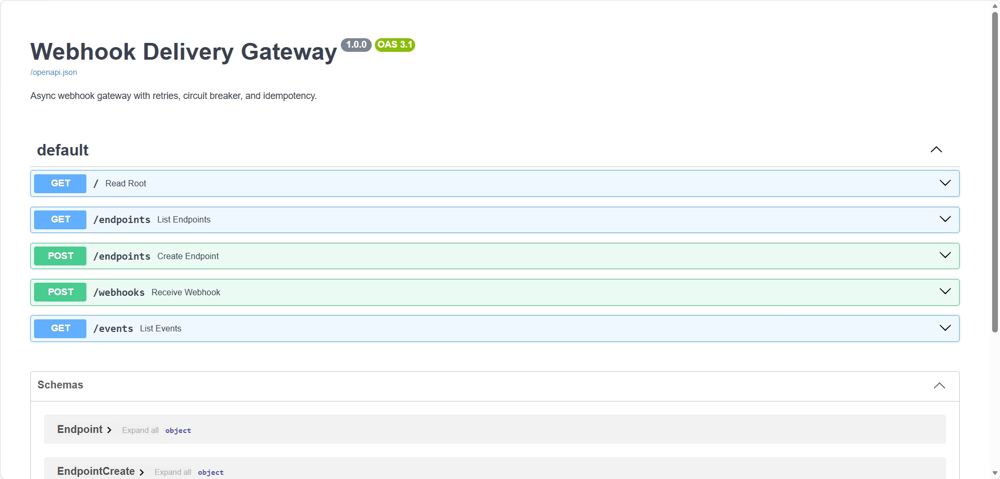
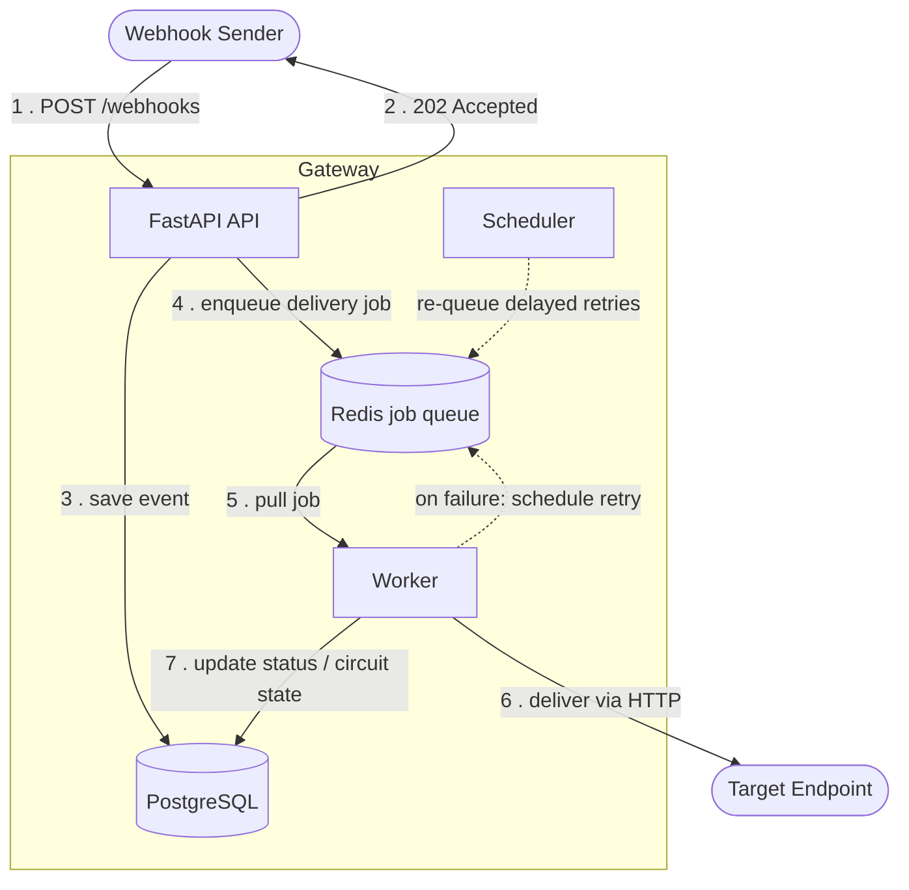
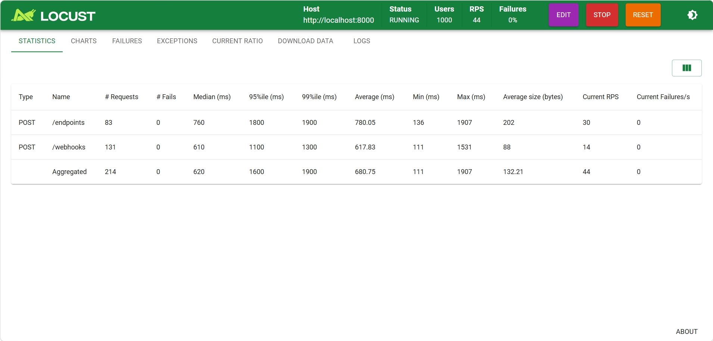

# Webhook Delivery Gateway

A production-style **webhook delivery service** built in Python. It receives webhook
events over an API and reliably delivers them to registered target endpoints —
asynchronously, with automatic retries, a per-endpoint circuit breaker, and
idempotency guarantees.

Built to demonstrate real distributed-systems patterns: asynchronous task
processing, resilience against failing downstreams.

---

## What it does

When a webhook event arrives, the API does **not** block to deliver it. It stores
the event, drops a delivery job onto a Redis-backed queue, and immediately returns
`202 Accepted`. Separate background processes handle delivery, retries, and timing —
so slow or failing target endpoints never block the API.

### Interactive API docs

FastAPI generates an interactive OpenAPI docs page at `/docs`:



## Key features

- **Asynchronous delivery** — API returns instantly; a worker delivers in the background.
- **Automatic retries with exponential backoff** — failed deliveries retry after
  growing delays (5s → 25s → 125s) before being marked failed.
- **Per-endpoint circuit breaker** — an endpoint that fails repeatedly is tripped
  (state: `open`) and its deliveries are skipped during a cooldown, protecting a
  struggling target from being hammered. It self-heals via a `half_open` test state.
- **Idempotency keys** — duplicate events (same key) are recognized and skipped, so a
  buggy sender that resends the same event still results in exactly one delivery.
- **Automated tests** — pytest suite covering the API, validation, and idempotency.
- **Load tested** — a Locust script simulates high concurrent traffic to verify the
  API stays responsive under burst load.
- **Fully containerized** — one command starts the whole system.

---

## Architecture



**Flow:** the API validates the event, returns `202 Accepted` to the sender
immediately (before any delivery happens), persists the event, and enqueues a
delivery job. A worker then pulls the job from Redis and attempts delivery. On
success it marks the event `delivered`; on failure it schedules a retry with
exponential backoff, and the scheduler re-queues that retry when its delay expires.
Repeated failures to one endpoint trip that endpoint's circuit breaker. The key
design point: the sender never waits for delivery — the API responds instantly and
delivery happens in the background.

## Tech stack

| Layer            | Technology                                    |
|------------------|-----------------------------------------------|
| Language         | Python 3.12                                   |
| API framework    | FastAPI                                        |
| Server           | Uvicorn                                        |
| Database         | PostgreSQL (SQLite for local dev)             |
| ORM              | SQLModel                                       |
| Queue            | Redis + RQ (Redis Queue)                       |
| Background jobs  | RQ worker + RQ scheduler                       |
| Outbound HTTP    | httpx                                          |
| Load testing     | Locust                                         |
| Containerization | Docker + Docker Compose                        |
| Testing          | pytest                                         |

---

## Why FastAPI

FastAPI fits this project for two concrete reasons:

- **Asynchronous by design.** The core of this gateway is "accept fast, deliver
  later." FastAPI is built for non-blocking request handling, which suits an API
  whose job is to validate, enqueue, and return `202` without waiting on slow
  downstream deliveries.
- **Automatic validation via Pydantic.** Request bodies are validated against typed
  models automatically — malformed requests are rejected with a clear `422` before
  any handler code runs, so the application logic only ever sees well-formed input.
- **Self-documenting.** FastAPI generates an interactive OpenAPI docs page at `/docs`
  out of the box, which makes the API easy to explore and test.

---

## Design decisions & trade-offs

Real engineering decisions made while building this, and the reasoning behind them:

- **RQ over Celery.** RQ (Redis Queue) provides exactly what this project needs —
  a simple job queue with a worker, retries, and scheduling — with far less
  configuration than Celery. Celery is more powerful (complex routing, multiple
  brokers) but that power wasn't warranted here. RQ keeps the system small and
  readable. For a larger system with more complex task orchestration, Celery would
  be the better fit.

- **PostgreSQL in production, SQLite in development.** SQLite needs zero setup, which
  made it ideal for building and for the test suite. But SQLite locks on writes and
  lives on a single machine — problematic when the API, worker, and scheduler all
  write concurrently. PostgreSQL handles concurrent access and runs as a shared
  network service. Because the code uses SQLModel, switching between them is a single
  environment variable, not a rewrite.

- **A separate scheduler process.** Delayed retries need a scheduler to re-queue them
  when their backoff expires. RQ's worker can run an in-process scheduler, but that
  relies on process forking, which is unavailable on Windows. Running the scheduler
  as its own standalone process solves this — and is closer to how these systems are
  deployed in production anyway (independent, separately scalable processes).

- **Queue-based delivery instead of inline.** The API could deliver webhooks
  synchronously, but a slow or unresponsive target would then block the request (and
  every other request behind it). Offloading delivery to a background worker keeps the
  API responsive regardless of how downstream endpoints behave — the central reason
  this architecture exists.

---

## Running it

### With Docker Compose (recommended — runs everything)

Starts PostgreSQL, Redis, the API, the worker, and the scheduler together:

```bash
docker compose up --build
```

Then open the interactive API docs at **http://localhost:8000/docs**.

### Locally (SQLite, for development)

```bash
pip install -r requirements.txt

# Terminal 1 — API
uvicorn app.main:app --reload

# Terminal 2 — worker
python worker.py

# Terminal 3 — scheduler
python scheduler.py
```
(Requires a local Redis, e.g. `docker run -d -p 6379:6379 redis`.)

---

## Trying it out

1. **Register an endpoint** — `POST /endpoints` with a target URL.
2. **Send a webhook** — `POST /webhooks` with the `endpoint_id` and a `payload`.
   The response returns instantly as `pending`; the worker delivers it in the background.
3. **Check delivery** — `GET /events` shows each event's status
   (`pending` → `delivered` / `failed` / `blocked`).

**See the circuit breaker:** register an endpoint with an unreachable URL, send it
several events, and watch `GET /endpoints` — after repeated failures the endpoint's
`circuit_state` flips to `open` and further events are `blocked`.

**See idempotency:** send the same event twice with the same `idempotency_key` — the
second is ignored and only one event is stored.

---

## Testing

Run the automated test suite:

```bash
pytest
```

## Load testing

Simulate high concurrent traffic against the API to verify it stays responsive under
burst load (the async design means the API returns `202` quickly even when many
requests arrive at once):

```bash
pip install locust
locust -f loadtest/locustfile.py --host http://localhost:8000
```

Then open Locust's dashboard at **http://localhost:8089**, set the number of users
(e.g. 1000) and spawn rate, and start the test. The dashboard reports requests per
second and response times live.

**Results — 1000 concurrent users, 0% failures:**

*1 delivery worker:*


*10 delivery workers (`docker compose up --scale worker=10`):*



Both runs handle 1000 concurrent users with **0% failures**. Adding workers requires
**no code changes** — they simply pull from the same Redis queue. On a single machine,
extra workers contend for the same CPU (shared with PostgreSQL, Redis, and the API), so
latency does not drop here; the design scales horizontally across multiple machines,
where each worker runs on its own resources.

---

## Project structure

```
webhook-gateway/
├── app/
│   ├── main.py             # FastAPI app + routes (receive, enqueue, idempotency)
│   ├── models.py           # database tables (Endpoint, Event)
│   ├── database.py         # DB connection (env-driven: SQLite or PostgreSQL)
│   ├── delivery.py         # outbound HTTP delivery (httpx)
│   ├── queue.py            # Redis connection + RQ queue
│   ├── tasks.py            # the delivery job (runs in the worker)
│   └── circuit_breaker.py  # circuit breaker logic
├── worker.py               # RQ worker process
├── scheduler.py            # RQ scheduler process (handles delayed retries)
├── loadtest/
│   └── locustfile.py       # Locust load test
├── tests/
│   └── test_api.py         # pytest suite
├── Dockerfile
├── docker-compose.yml
└── requirements.txt
```
